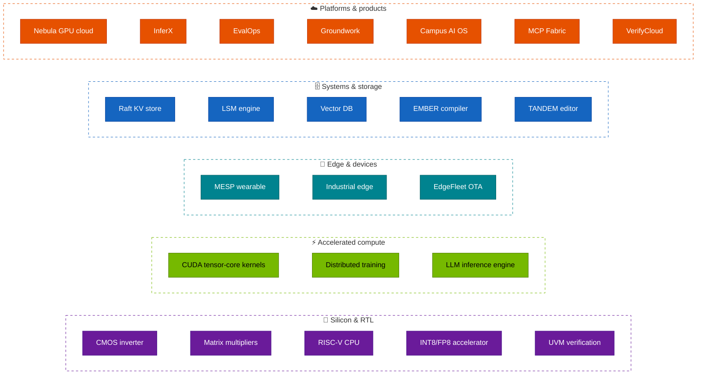

<!-- ═══════════════════════════  HEADER  ═══════════════════════════ -->
<p align="center">
  
</p>

<p align="center">
  <a href="https://github.com/siddhaantxsingh">
    
  </a>
</p>

<!-- ═══════════════════════════  PROFILES (all clickable)  ═══════════════════════════ -->
<p align="center">
  <a href="https://www.linkedin.com/in/LINKEDIN_SLUG/"></a>
  <a href="https://leetcode.com/u/LEETCODE_USERNAME/"></a>
  <a href="https://codeforces.com/profile/CODEFORCES_HANDLE"></a>
  <a href="https://www.codechef.com/users/CODECHEF_HANDLE"></a>
  <a href="HDLBITS_URL"></a>
  <a href="mailto:siddhaantxsingh@gmail.com"></a>
  <a href="RESUME_URL"></a>
</p>

<p align="center">
  
  
  
</p>

---

<!-- ═══════════════════════════  ABOUT — written as hardware  ═══════════════════════════ -->

<table>
<tr>
<td width="55%" valign="top">

### ⚡ `$ whoami`

```systemverilog
module siddhant_singh #(
  parameter string  SCHOOL  = "MIT Manipal",
  parameter string  DEGREE  = "B.Tech ECE — VLSI Design & Technology",
  parameter string  HOME    = "Jamshedpur, India",
  parameter int     GRAD    = 2028
)(
  input  logic        clk,           // coffee
  input  logic [7:0]  hard_problem,
  output logic [63:0] shipped_system
);
  // software engineer who can also read a timing report
  always_ff @(posedge clk) begin
    if (hard_problem != '0)
      shipped_system <= measure(fix(break_on_purpose(
                          build(hard_problem))));
  end

  // SVA: I don't claim what I haven't measured
  assert property (@(posedge clk)
    claim |-> ##[0:$] evidence);
endmodule
```

</td>
<td width="45%" valign="top">

### 🧭 Right now

- 🎓 **B.Tech ECE (VLSI)** at **MIT Manipal**
- 🏭 **ML Intern @ Tata Steel** (Jun–Jul 2026)
- 🧪 **Published research paper** → [read it](PAPER_URL)
- 🏁 **Arm Bharat AI-SoC Challenge 2026–27** — team entry
- 🔨 **23 tested systems** across SWE, AI infra and silicon
- 🎯 Looking for **SDE / VLSI / ML-infra** internships & new-grad roles (2027)

### 💬 Ask me about

Raft · LSM trees · CRDTs · paged KV caches · tensor cores · ZeRO · systolic arrays · UVM · timestamp reconstruction for sensor streams

</td>
</tr>
</table>

---

<!-- ═══════════════════════════  HOW IT ALL CONNECTS  ═══════════════════════════ -->

## 🗺️ One engineer, the whole stack

> From a MOSFET simulated in Sentaurus, to a RISC-V core in GDSII, to CUDA kernels, to an LLM serving engine, to the cloud control plane that schedules it — every layer built and tested.



---

<!-- ═══════════════════════════  PROOF WALL  ═══════════════════════════ -->

## 🏆 The proof wall

<p align="center"><i>Not "built a X". Here's what each one <b>survived</b>.</i></p>

### 🗄️ Distributed systems & storage

| Project | What it is | Proof |
|---|---|---|
| 🗳️ **[RAFT-KV](https://github.com/siddhaantxsingh/RAFT-KV)** | Linearizable distributed KV store in Go, zero dependencies | Chaos runs all linearizable · 5-node failover ≤ **757 ms** |
| 🌲 **[LSM_ENGINE](https://github.com/siddhaantxsingh/LSM_ENGINE)** | LSM-tree storage engine in Rust | **6,055** power-loss crash images verified · **9,247** bit flips, 0 silent |
| 🧭 **[VECTORDB](https://github.com/siddhaantxsingh/VECTORDB)** | Persistent HNSW + PQ vector search in Rust | recall@10 **0.9999** · ≥ FAISS · **15.4×** compression |
| 🔥 **[EMBER](https://github.com/siddhaantxsingh/EMBER-Compiler)** | Typed language → optimizing compiler → GC'd VM → LLVM JIT (C++20) | **20,000** differential programs, 0 failures · fuzzed, ASan/UBSan clean |
| ✍️ **[TANDEM](https://github.com/siddhaantxsingh/TANDEM-Collaborative-Editor)** | Real-time collaborative code editor | `kill -9` mid-write: **3,706 acks, 0 lost** |

### ⚡ AI infrastructure

| Project | What it is | Proof |
|---|---|---|
| 🦀 **[LLM-INFERENCE-ENGINE](https://github.com/siddhaantxsingh/LLM-INFERENCE-ENGINE)** | vLLM-style server from scratch in Rust: paged KV, continuous batching, speculative decoding | Perplexity **18.8685** vs llama.cpp 18.8695 · **3.1×** batching throughput |
| 🟩 **[CUDA-KERNELS](https://github.com/siddhaantxsingh/CUDA-KERNELS)** | Naive → tensor-core kernels + a CPU SIMT emulator | `HMMA.16816.F32` in SASS · **170/170** checks · 0 spills on sm_80/89/90 |
| 🌐 **[DISTRIBUTED-TRAINING](https://github.com/siddhaantxsingh/DISTRIBUTED-TRAINING)** | DDP + ZeRO-1 + ring all-reduce from first principles | Matches PyTorch DDP to **1.6e-15** · crash-resume **bit-identical** |
| 🚦 **[INFERX](https://github.com/siddhaantxsingh/INFERX)** | KV-cache-aware LLM gateway + autoscaler | **1.68×** req/s · cache hits **48% → 66%** |
| ☁️ **[NEBULA](https://github.com/siddhaantxsingh/NEBULA_GPU_CLOUD)** | Multi-tenant GPU cluster control plane in Rust | EASY backfill **3.5×** lower wait · journal crash-tested at every byte |
| 📏 **[EVALOPS](https://github.com/siddhaantxsingh/EVALOPS)** | CI for LLMs with a significance-aware regression gate | False-positive rate **2–9%** at α = 0.05 · power **> 90%** |
| 📚 **[GROUNDWORK](https://github.com/siddhaantxsingh/GROUNDWORK)** | RAG engine where every sentence cites and is checked | NDCG@10 **0.470 → 0.550** · 5.8 ms answers |
| 🔐 **[MCP-FABRIC](https://github.com/siddhaantxsingh/MCP-FABRIC)** | Secure federating gateway for Model Context Protocol | alg=none / key-confusion JWT attacks rejected · **~2.3 ms** overhead |
| 🎓 **[CAMPUS-AI-OS](https://github.com/siddhaantxsingh/CAMPUS-AI-OS)** | Multi-tenant course Q&A with k-anonymous analytics | **10/10** audit defects fixed · 100% cited answers |

### 🔬 Silicon, RTL & verification

| Project | What it is | Proof |
|---|---|---|
| 🧠 **[RISCV-CPU](https://github.com/siddhaantxsingh/RISCV-CPU)** | RISC-V core with caches, taken through sky130 | **64/64** riscv-tests · **400/400** identical to Spike · ~96k random IRQs precise |
| 🔢 **[INT8-FP8 accelerator](https://github.com/siddhaantxsingh/INT8-FP8-ACCELARATOR)** | N×N systolic array with exact FP8 accumulation | Bit-exact vs golden model · PE routed to **GDSII @ 100 MHz** |
| ✅ **[UVM-SOC-VERIFICATION](https://github.com/siddhaantxsingh/UVM-SOC-VERIFICATION)** | UVM environment for an APB subsystem | **23** SVA properties · RAL · tested with the bugs it must catch |
| 🏭 **[VerifyCloud](https://github.com/siddhaantxsingh/VerifyCloud)** | CI for hardware: sandboxed RTL regression farm | **0** duplicate claims in 8,080 · **6/6** adversarial RTL contained |
| ⚖️ **[Matrix multipliers](https://github.com/siddhaantxsingh/Comparative-Analysis-Of-Different-Kind-of-Matrix-Multipliers-Using-Verilog)** | Serial vs parallel vs pipelined in a 90 nm Cadence flow | **9/9** designs meet 250 MHz · parallel = **82×** serial throughput |
| 🔌 **[CMOS inverter](https://github.com/siddhaantxsingh/MIXED-NODE-CMOS-INVERTER)** | Mixed-mode inverter in Sentaurus + my own DEVSIM model | t<sub>p</sub> **33.3 ps** @ 10 fF · peak gain **18.6** |

### 📡 Edge, IoT & devices

| Project | What it is | Proof |
|---|---|---|
| 🫀 **[MESP platform](https://github.com/siddhaantxsingh/Mesp_platform)** | STM32 + BLE wearable → real-time ECG/PPG/IMU console | **~6,400** frames/s · firmware golden vectors byte-exact · **122** tests |
| 🏭 **[INDUSTRIAL_EDGE](https://github.com/siddhaantxsingh/INDUSTRIAL_EDGE)** | Modbus → edge analytics → INT8 model → MQTT/TLS, in Go | `kill -9` + broker outage: **0 records lost** · 11 KB INT8 model |
| 🛰️ **[EDGEFLEET](https://github.com/siddhaantxsingh/EDGEFLEET)** | Signed OTA with canary waves and A/B rollback | Bad release reached **15 of 2,000** devices — all self-healed |

---

<!-- ═══════════════════════════  TECH STACK  ═══════════════════════════ -->

## 🧰 Toolbox

<p align="center"><b>Languages</b><br/>
  
</p>
<p align="center"><b>Hardware</b><br/>
  
  
  
  
  
  
  
  
</p>
<p align="center"><b>Systems, AI & cloud</b><br/>
  
</p>

---

<!-- ═══════════════════════════  COMPETITIVE PROGRAMMING  ═══════════════════════════ -->

## ⚔️ Competitive programming

<p align="center">
  <a href="https://leetcode.com/u/LEETCODE_USERNAME/">
    
  </a>
  <a href="https://codeforces.com/profile/CODEFORCES_HANDLE">
    
  </a>
</p>

<p align="center">
  <a href="https://codeforces.com/profile/CODEFORCES_HANDLE"></a>
  <a href="https://codeforces.com/profile/CODEFORCES_HANDLE"></a>
  <a href="HDLBITS_URL"></a>
</p>

<p align="center"><sub>Ratings above are fetched live, so they are always current.</sub></p>

---

<!-- ═══════════════════════════  GITHUB STATS  ═══════════════════════════ -->

## 📊 GitHub in numbers

<p align="center">
  
  
</p>

<p align="center">
  
</p>

<p align="center">
  
</p>

<p align="center">
  
</p>

<!-- Snake: generated daily by .github/workflows/snake.yml -->
<p align="center">
  <picture>
    <source media="(prefers-color-scheme: dark)" srcset="https://raw.githubusercontent.com/siddhaantxsingh/siddhaantxsingh/output/github-snake-dark.svg"/>
    <source media="(prefers-color-scheme: light)" srcset="https://raw.githubusercontent.com/siddhaantxsingh/siddhaantxsingh/output/github-snake.svg"/>
    
  </picture>
</p>

---

<!-- ═══════════════════════════  PHILOSOPHY  ═══════════════════════════ -->

## 🧪 How I build

<table>
<tr>
<td align="center" width="25%">💥<br/><b>Break it on purpose</b><br/><sub>kill -9, power-loss images, bit flips, chaos tests</sub></td>
<td align="center" width="25%">🎯<br/><b>Check against a reference</b><br/><sub>PyTorch, Spike, llama.cpp, FAISS, RocksDB</sub></td>
<td align="center" width="25%">🧬<br/><b>Test the tests</b><br/><sub>mutation runs and injected bugs must fail the suite</sub></td>
<td align="center" width="25%">📏<br/><b>Say what isn't proven</b><br/><sub>every repo lists its own limitations</sub></td>
</tr>
</table>

---

<p align="center">
  <a href="https://www.linkedin.com/in/LINKEDIN_SLUG/"><b>LinkedIn</b></a> ·
  <a href="https://leetcode.com/u/LEETCODE_USERNAME/"><b>LeetCode</b></a> ·
  <a href="https://codeforces.com/profile/CODEFORCES_HANDLE"><b>Codeforces</b></a> ·
  <a href="https://www.codechef.com/users/CODECHEF_HANDLE"><b>CodeChef</b></a> ·
  <a href="HDLBITS_URL"><b>HDLBits</b></a> ·
  <a href="mailto:siddhaantxsingh@gmail.com"><b>Email</b></a> ·
  <a href="RESUME_URL"><b>Résumé</b></a>
</p>

<p align="center">
  
</p>
